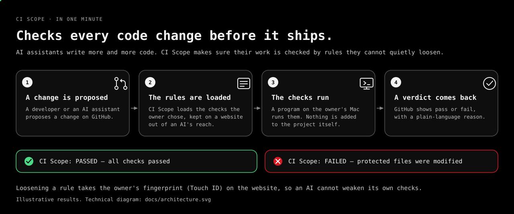
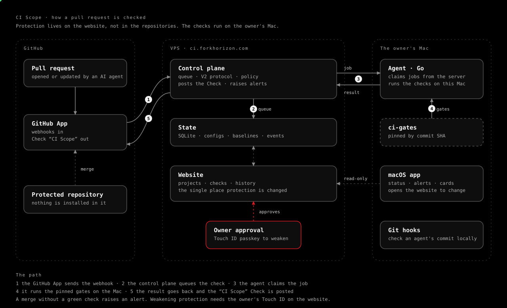

# CI Scope

CI Scope keeps AI coding agents honest. Protection lives on the website (`https://ci.forkhorizon.com`), not in the
repositories: one GitHub check, "CI Scope", is posted by the GitHub App for every pull request, and the checks run on
this Mac. Nothing is installed into the protected repositories.

> **Status: working prototype, macOS only.** CI Scope currently runs for its author on a single Mac, with the
> control plane on a VPS. Other platforms are planned but not built. This repository is public so the app, the agent
> and the checks can be read; it is not a packaged product yet and has no installer. A license has not been chosen
> yet, so all rights are reserved until one is added.
>
> Interested in the idea, or in developing or collaborating on it? Get in touch via
> [forkhorizon.com/ci-scope](https://forkhorizon.com/ci-scope).



## The two halves

- **Website** (`CI-Scope-Web`, private for now): add a project, choose its checks and limits, record the protected-file baseline,
  read the history. Weakening any protection needs the owner's Touch ID on the website.
- **macOS app** (this repository): shows each project's protection and open alerts, raises a notification when
  someone tampers with the checks, opens the website for changes, installs the git hooks on this Mac and runs the
  agent that executes the checks.

## How a pull request is checked

1. The GitHub App sends the webhook to the website, which queues the check for the project.
2. The agent on this Mac claims it, runs the pinned gates from `ci-gates` and reports the result.
3. The website posts the "CI Scope" check. A merge without a green check raises an alert.

## Architecture

The current path, for engineers:



## Related repositories

- [`ForkHorizon/ci-gates`](https://github.com/ForkHorizon/ci-gates) (public): the pinned checks the agent runs.
- `ForkHorizon/CI-Scope-Web` (private for now): the control plane and website. Ask if you would like to see it.

## Layout

- `CI Scope/`: the macOS app (SwiftUI). `ServerLinks.swift` holds the website addresses, `ProjectConfigClient*.swift`
  and `SecurityEvents*.swift` talk to the website API.
- `agent/`: the Go agent (`ci-scope-agent`) that claims and runs the checks. Wire protocol: `agent/protocol*.go`.
- `scripts/`: helpers for provisioning keys.

## Build

Open `CI Scope.xcodeproj` and run the `CI Scope` scheme, or build from the command line:

```bash
xcodebuild -scheme "CI Scope" -destination 'platform=macOS' build
xcodebuild -scheme "CI ScopeTests" -destination 'platform=macOS' test
```

The agent: `cd agent && go build ./... && go test ./...`.

## Safety

The agent must not be started against the VPS outside a controlled canary window. Secrets are never printed or
committed: the app reads them from the server over SSH only after Touch ID.
